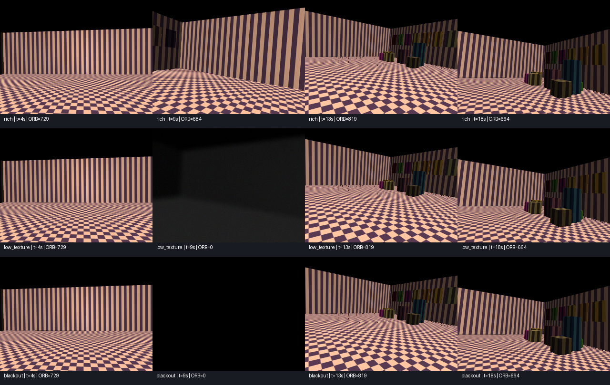

# MuJoCo test environment for MM3DGS SLAM

A runnable RGB-D + IMU simulator, dataset exporter, replay interface, and trajectory evaluator for testing the visual/inertial method in the attached MM3DGS paper. The room, sensor rig, motion, and assets are generated locally. No ROS, downloaded meshes, or robot controller is required.

## Quick start

Python 3.10+ on Linux, macOS, or Windows:

```bash
python -m venv .venv
source .venv/bin/activate  # Windows: .venv\Scripts\activate
pip install -e '.[test]'
mm3dgs-bench preview --out runs/preview
mm3dgs-bench generate --scenario suite --out runs/suite --width 320 --height 240
pytest -q
```

On headless Linux the simulator defaults to EGL. This was exercised with Mesa software rendering, without a GPU. If EGL is unavailable, install your distribution's Mesa EGL runtime (`libegl1` and `libgl1-mesa-dri` on Ubuntu). An OSMesa installation can use `MUJOCO_GL=osmesa`; desktop Linux can use `MUJOCO_GL=glfw` with a display. On macOS/Windows MuJoCo selects its platform default; those platforms were not tested here.

The default full resolution is 640×480. Use 320×240 for a faster first run. Dataset output directories must not already exist. A 24-second, 320×240 sequence uses about 280 MB before ZIP compression. `scene.xml` can be loaded directly in MuJoCo, but trajectory playback and sensor degradation are implemented by the Python environment.

## Preview video

[Watch or download the 24-second simulator preview](docs/blackout_preview.mp4).

The left panel is a clean reference for visualization only. The right panel is the camera input, with RGB and depth unavailable from 8–12 seconds while the rig continues to move. This video shows sensor input, not a SLAM reconstruction.



To regenerate a video from an exported sequence (requires `ffmpeg`):

```bash
python scripts/make_preview.py runs/suite/blackout --out runs/blackout_preview.mp4
```

## Experiments

All three sequences use identical geometry, trajectory, camera/IMU calibration, and seeded IMU noise. They start with rich visual initialization and end with visual recovery.

| Scenario | 0–8 seconds | 8–12 seconds | 12–24 seconds |
| --- | --- | --- | --- |
| `rich` | Textured room | Textured room, normal depth | Textured room |
| `low_texture` | Textured room | Uniform materials, dim light approximation, blur, pixel noise; depth unavailable | Textures and depth return |
| `blackout` | Textured room | RGB exactly black; depth unavailable | RGB and depth return |

The rig is stationary for the first and last two seconds. Between these periods it follows a smooth loop with acceleration, changing yaw, roll, pitch, and height. During the outage it continues to accelerate and rotate. There are no contacts or controller tracking errors. MuJoCo inverse dynamics supplies the wrench for the prescribed trajectory, and forward dynamics produces actual accelerometer and gyro readings. This is a sensor benchmark, not a robot navigation/control task.

The default run is 24 seconds with 30 Hz cameras, 100 Hz IMU (matching the paper), and a 600 Hz simulation sampling grid. It exports 721 frames and 2,401 IMU samples, including t=0 and t=24. Sensor timestamps come from the same clock. Camera and IMU rates must divide `physics_hz`. Higher IMU rates, seeds, outage intervals, and duration are configurable:

```bash
mm3dgs-bench generate --scenario blackout --out runs/blackout_seed11 --seed 11
mm3dgs-bench generate --scenario blackout --out runs/blackout_200hz --imu-hz 200
mm3dgs-bench generate --scenario blackout --out runs/long_outage --blackout-start 7 --blackout-end 14
```

The official-code bridge requires the native 100 Hz setting because upstream hardcodes its IMU integration interval.

### What this establishes about tight coupling

The attached paper's Section III-D describes open-loop IMU pose initialization and leaves closed-loop fusion with bias estimation for future work. The current official repository additionally contains an optional IMU pose-prior loss; this is not a full bias-estimating inertial factor graph.

The blackout removes all instantaneous visual and depth information while motion changes, making inertial information important for continued motion estimation. It does **not**, by itself, prove that tightly coupled fusion is necessary: a well-initialized loosely coupled filter or inertial propagator can bridge a short outage too. Even tightly coupled VIO drifts during complete visual loss. To support a tight-coupling claim, compare these on the same exported measurements, over multiple seeds and outage lengths:

1. Visual tracking with constant-velocity prediction.
2. The paper's visual tracking with IMU pose initialization.
3. Your tightly coupled visual/inertial estimator, with joint pose, velocity, and bias estimation and inertial residuals in optimization.

Compare normal operation, outage drift, return-to-vision behavior, and tracking coverage. Do not count an estimator that stops returning poses as successful. Use `low_texture` for weak visual constraints that remain available to a coupled optimizer, and `blackout` for strict loss of visual information.

Depth is deliberately gated in the hard interval, since healthy depth can let an RGB-D estimator succeed despite bad RGB. `--depth-mode off` disables depth throughout for monocular experiments; `--depth-mode clean` retains simulated depth during visual degradation as an explicit depth-assisted control. Outside the outage, simulated depth includes 5 mm independent noise and a 0.1–20 m validity range. It is a simple axial depth sensor model, not a stereo reconstruction model. Images have instantaneous global exposure; the low-texture blur is an image-space approximation, not physical exposure integration. The simulator models neither rolling shutter nor time offsets.

## Official MM3DGS connection

Project: https://vita-group.github.io/MM3DGS-SLAM/

Repository: https://github.com/VITA-Group/MM3DGS-SLAM

Bridge source was checked against upstream commit `1fae9f5d1ad50a6159717b711ae54325422202e2`. The simulator works on CPU. The official Gaussian rasterizer requires a CUDA GPU and its separate upstream environment; that full SLAM pipeline could not be executed in the supplied CPU-only workspace.

Prepare the official checkout and install its environment following its README. Its documented environment uses Python 3.10, PyTorch, CUDA, and a Gaussian rasterizer submodule. Keep that environment separate from the simulator venv.

```bash
git clone --recursive https://github.com/VITA-Group/MM3DGS-SLAM.git /path/to/MM3DGS-SLAM
```

The provided launcher uses a dedicated loader to read this benchmark's PNG/float-depth files, exact camera poses for evaluation, and correctly grouped raw IMU samples. It provides the 37-column raw-IMU layout used by upstream and the camera-to-IMU extrinsic. It avoids the native UT-MM loader's fixed camera/body transform and ROS-specific text assumptions. It does not edit upstream files or add tight coupling.

Prepare complete native configs from the simulator environment:

```bash
python scripts/run_mm3dgs.py --repo /path/to/MM3DGS-SLAM \
  --dataset runs/suite/rich --mode cv --output runs/results/rich_cv --prepare-only
python scripts/run_mm3dgs.py --repo /path/to/MM3DGS-SLAM \
  --dataset runs/suite/rich --mode imu --output runs/results/rich_imu --prepare-only
```

Then run the same launcher commands, without `--prepare-only`, in the **official MM3DGS CUDA environment**. Repeat for `low_texture` and `blackout`. The launcher selects native dimensions, stride 1, simulated depth, `tracking.use_gt_pose=false`, and either constant velocity or IMU initialization. It adjusts upstream's gravity constant to the simulator's 9.81 m/s², keeping its relative first-camera world convention. In this config the upstream name `use_gt_depth=true` means use the supplied simulated depth stream, which is gated during the outage; it does not supply clean hidden depth.

The native tracker/mapper may fail on black images or all-invalid depth, including empty masks and undefined Pearson correlations. That is a valid failure of the unmodified method on this stress test. The launcher does not fabricate measurements or skip the difficult interval. A robust estimator should propagate on IMU, reject invalid visual/depth updates, suspend mapping when observations are unusable, and estimate biases when information returns. No full MM3DGS tracking, mapping, or reconstruction accuracy is claimed by the included sensor diagnostics.

Convert its output and evaluate:

```bash
python scripts/results_to_tum.py runs/suite/rich runs/results/rich_imu/results.npz \
  --out runs/results/rich_imu/estimate.tum
mm3dgs-bench evaluate runs/suite/rich runs/results/rich_imu/estimate.tum \
  --out runs/results/rich_imu/metrics.json
```

Upstream stores world-to-camera poses with `wxyz` quaternions; conversion produces camera-to-world TUM rows with `xyzw` quaternions. The provided evaluator fixes a metric SE(3) alignment at the first matched pose, never estimates scale or realigns after the outage, and reports ATE, 1-second RPE, and overall/per-interval coverage. Upstream's internal evaluation uses a different alignment, so numbers need not agree. Its current `save_results` can omit the final frame; coverage exposes this.

## Connect another tightly coupled estimator

Implement this Python interface (timestamps are integer nanoseconds; IMU uses SI units):

```python
class Estimator:
    def reset(self, calibration):
        # K, T_B_C, T_B_I, gravity, noise densities, frame conventions.
        ...

    def process_imu(self, sample):
        # sample: timestamp_ns, accel[3] specific force, gyro[3] rad/s
        ...

    def process_frame(self, frame):
        # frame: timestamp_ns, rgb uint8 HxWx3 RGB, depth float32 HxW metres.
        # Depth zero means invalid; it is not a distance measurement.
        # Return 4x4 T_W_C, or None if no estimate is available.
        ...
```

```bash
mm3dgs-bench replay runs/suite/blackout --estimator my_estimator:Estimator --out runs/tight.tum
mm3dgs-bench replay runs/suite/blackout --estimator my_estimator:Estimator --no-imu --out runs/visual.tum
mm3dgs-bench evaluate runs/suite/blackout runs/tight.tum
```

Replay feeds each IMU sample before a camera at the same time, uses only past/present IMU measurements, and does not pass ground truth, planted bias values, scenario timing, or the deterministic seed to the estimator. The dataset includes ground truth for evaluation, so an external implementation must respect this separation. Generation metadata in `calibration.json` includes planted biases for reproducibility and must not be manually fed into an estimator.

For direct online use, construct `SLAMEnvironment(Config(...))` and call `next_tick()` until `StopIteration`; it returns `imu` and/or `camera` events when due. `render=False` disables cameras for sensor-only checks. `calibration()` returns safe sensor calibration; `calibration(include_generation=True)` also includes generation metadata. Access `ground_truth()` only in evaluation code. Always close the renderer or use a context manager.

## Data and coordinates

```
calibration.json          intrinsics, transforms, noise model, generation metadata
scene.xml                 self-contained MuJoCo model
frames.csv                timestamp_ns, relative RGB path, relative depth path
imu.csv                   timestamp_ns, wx, wy, wz, ax, ay, az
rgb/*.png                 RGB images (load as RGB, not OpenCV's default BGR)
depth/*.npy               float32 axial depth in metres; 0 invalid
summary.json              counts and scenario
groundtruth/camera.tum     time_seconds, px py pz, qx qy qz qw; T_W_C
groundtruth/states.csv     body poses, velocities, and actual time-varying biases
```

`T_A_B` maps coordinates from B to A. World z points up. The body/IMU uses x forward, y left, z up. The optical camera uses x right, y down, z forward. The camera is offset 8 cm forward and 4 cm upward from the IMU. The accelerometer measures `R_W_B.T @ (a_W - g_W)`: at rest it reads approximately **+9.81 along body z**, not zero. Gyro samples are body angular velocity. White-noise sample standard deviation is `density*sqrt(sample_rate)` and bias random-walk increments have standard deviation `rw/sqrt(sample_rate)`. Bias and noise are nonzero by default. Noisy quantities are generated from separate camera and IMU RNG streams.

## Verification and preview

`pytest -q` checks actual MuJoCo sensors against rigid-body kinematics, analytic trajectory derivatives, optical extrinsics/depth against ray intersections, sensor timing, deterministic resets, outage gating/recovery, matched scenarios, export/replay separation, and trajectory scoring. Optional bridge tests run when PyTorch is installed. `requirements-tested.txt` records the exact packages used in the simulator test environment; PyTorch is optional and belongs in the separate official environment for real SLAM.

`mm3dgs-bench preview` writes a comparison image and JSON diagnostics. Its outage sanity check starts from an **oracle boundary pose and velocity**, estimates biases during the stationary warm-up, then propagates noisy IMU data through the outage. This checks sensor utility; it is not VIO, SLAM, mapping, or evidence that tight coupling beats loose fusion. ORB keypoint counts in the preview are image diagnostics only; MM3DGS uses dense photometric tracking.

The upstream-derived config template is attributed in `scripts/THIRD_PARTY.md` and accompanied by its original license.
